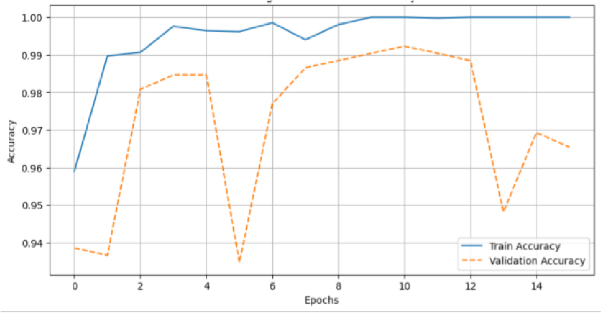
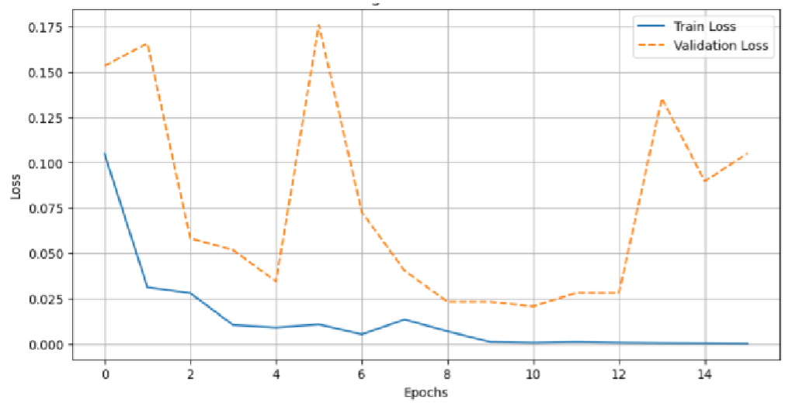
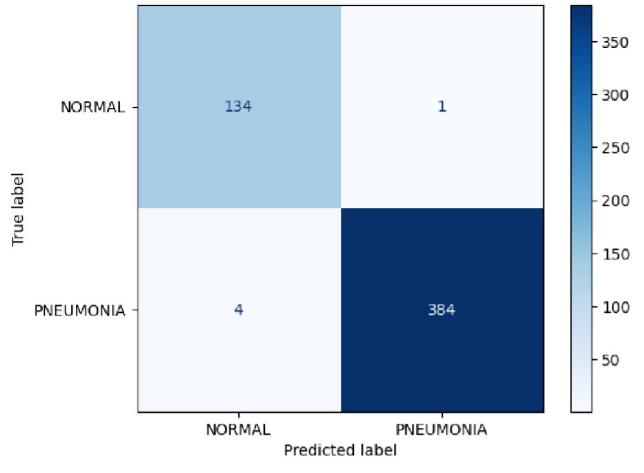
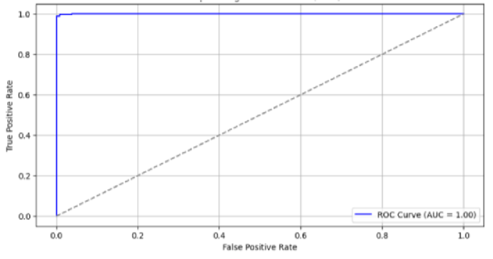
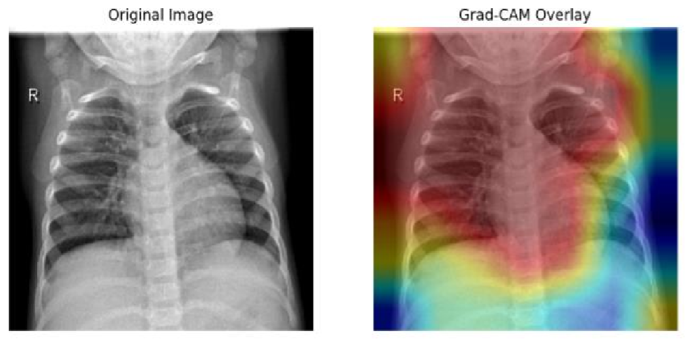

# Ensemble Transfer Learning for Pneumonia Detection

[](https://ieeexplore.ieee.org/document/11031996)
[](https://ieeexplore.ieee.org/document/11031996)
[](https://github.com/Pragyan127/Ensemble-Transfer-Learning-for-Pneumonia-Detection)
[](https://github.com/Pragyan127/Ensemble-Transfer-Learning-for-Pneumonia-Detection/commits/main)
[](https://orcid.org/0009-0003-6690-3624)
[](https://colab.research.google.com/github/Pragyan127/Ensemble-Transfer-Learning-for-Pneumonia-Detection/blob/main/Ensemble-Transfer-Learning-for-Pneumonia-Detection.ipynb)

Official code for the paper
[Ensemble Deep Learning Approach for Pneumonia Detection Using DenseNet, MobileNet, and EfficientNet with Transfer Learning](https://ieeexplore.ieee.org/document/11031996),
presented at ICDSBS 2025 (IEEE), Coimbatore, India.

## Overview

Pneumonia is still a leading cause of death in young children, and reading chest X-rays is slow and hard to do well where radiologists are scarce. This project builds a classifier that labels a chest X-ray as normal or pneumonia.

The model combines three ImageNet-pretrained networks (DenseNet121, MobileNet and EfficientNet). Each one extracts features from the image, the features are concatenated, and a small fully connected head makes the final prediction. On the held-out test set it reaches **99.24% accuracy**, ahead of each single network trained on the same data.

## Dataset

- Source: [Chest X-ray Images (Pneumonia) on Kaggle](https://www.kaggle.com/datasets/paultimothymooney/chest-xray-pneumonia)
- Size: about 5,860 chest X-ray images, labelled Normal or Pneumonia
- Split: 70% train, 15% validation, 15% test (523 test images)
- Preprocessing: images resized to 224 x 224 and scaled to the 0 to 1 range
- Augmentation: rotation, flip, zoom and shift

The dataset is not stored in this repository. Download it from Kaggle and place it in a folder named `data/` (see How to run).

## Model

| Part | Details |
|------|---------|
| Backbones | DenseNet121, MobileNet, EfficientNet |
| Initial weights | ImageNet |
| Fine-tuning | Last 2 blocks of each backbone unfrozen |
| Fusion | Globally pooled features from the three networks are concatenated |
| Head | Fully connected layers with dropout |
| Optimizer | Adam, learning rate 1e-4 with decay on plateau |
| Regularization | Early stopping on validation loss |

Concatenating features, instead of averaging the three networks' predictions, lets the classifier learn how much to rely on each network.

## Results

Test set of 523 images:

| Metric | Value |
|--------|-------|
| Accuracy | 99.24% (as reported in the paper) |
| Precision | about 0.99 |
| Recall | about 0.99 |
| F1-score | about 0.99 |
| ROC-AUC | close to 1.0 |

The confusion matrix shows 134 normal and 384 pneumonia images classified correctly, with 1 false positive and 4 false negatives. Most false negatives were low contrast or poorly aligned X-rays.

### Training curves

<table>
  <tr>
    <td><br><div align="center"><b>Accuracy over epochs</b></div></td>
    <td><br><div align="center"><b>Loss over epochs</b></div></td>
  </tr>
</table>

### Confusion matrix

<div align="center">
  
</div>

### ROC curve

<div align="center">
  
</div>

### Sample prediction

<div align="center">
  
  <br>
  <b>Predicted: Pneumonia | True: Pneumonia</b>
</div>

## Limitations

- The data is split randomly by image. The public dataset likely contains several images from the same patient, so a patient-level split could give lower numbers.
- The model was evaluated on one dataset only. It has not been tested on external hospital data.
- This is a research prototype and not a medical device.

## How to run

1. Clone the repository:
   ```bash
   git clone https://github.com/Pragyan127/Ensemble-Transfer-Learning-for-Pneumonia-Detection.git
   cd Ensemble-Transfer-Learning-for-Pneumonia-Detection
   ```
2. Optionally create a virtual environment:
   ```bash
   python -m venv venv
   source venv/bin/activate  # on Windows: venv\Scripts\activate
   ```
3. Install the requirements:
   ```bash
   pip install -r requirements.txt
   ```
4. Download the [Kaggle dataset](https://www.kaggle.com/datasets/paultimothymooney/chest-xray-pneumonia) and extract it into a folder named `data/`.
5. Open and run the notebook:
   ```bash
   jupyter notebook Ensemble-Transfer-Learning-for-Pneumonia-Detection.ipynb
   ```
   You can also run it in JupyterLab, VS Code or Colab. A GPU is recommended.

## Authors

- [Pragyan Dhungana](https://github.com/Pragyan127)
- [Shatrudhan Chaudhary](https://github.com/jassatish)
- Mithu Roy
- [Rupak Aryal](https://github.com/Rupak1620)
- Pragya Dhungana
- Mahesh T R (advisor)

## Citation

If you use this work, please cite:

```bibtex
@inproceedings{dhungana2025ensemble,
  title={Ensemble Deep Learning Approach for Pneumonia Detection Using DenseNet, MobileNet, and EfficientNet with Transfer Learning},
  author={Dhungana, Pragyan and Chaudhary, Shatrudhan and Roy, Mithu and Mahesh, T. R. and Aryal, Rupak and Dhungana, Pragya},
  booktitle={ICDSBS 2025},
  year={2025},
  publisher={IEEE},
  doi={10.1109/ICDSBS63635.2025.11031996},
  url={https://ieeexplore.ieee.org/document/11031996}
}
```

## Contact

Pragyan Dhungana: [pragyan0814@gmail.com](mailto:pragyan0814@gmail.com) | [LinkedIn](https://www.linkedin.com/in/pragyan127/)

## License

MIT, see the [LICENSE](LICENSE) file.
